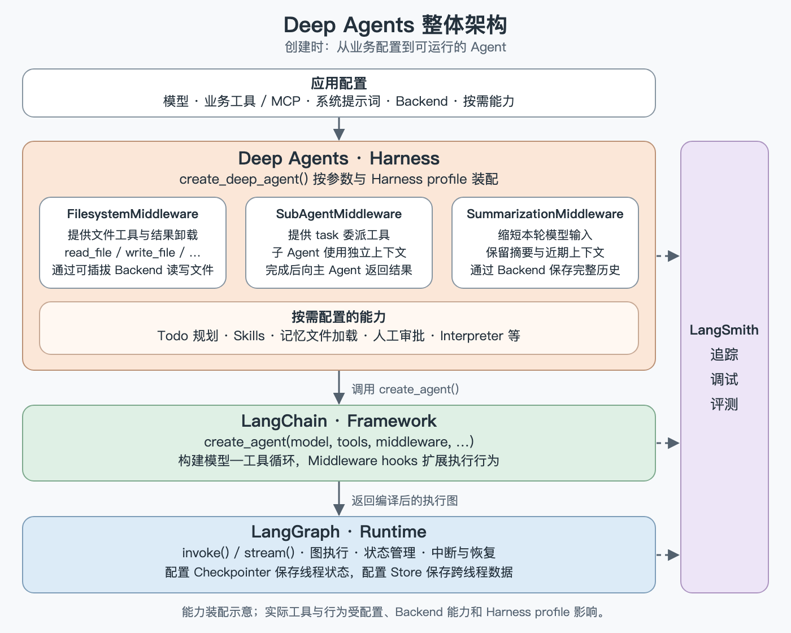
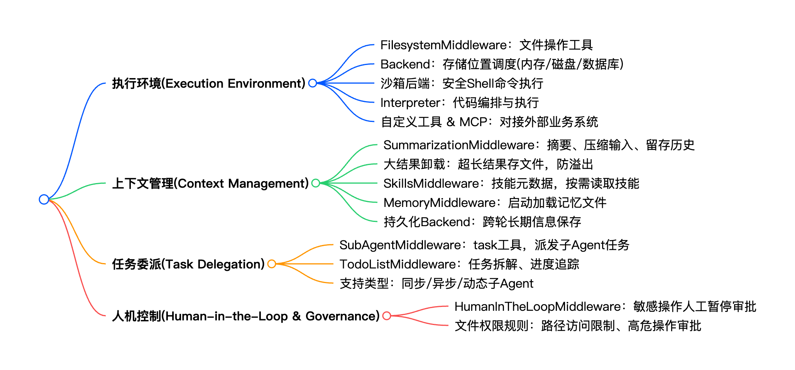

# agent开发的三个层次
### 底层（运行层）以langgraph为主
类比本质是agent的底层操作系统
### 中间层，以Langchain为主
本质是把langgraph封装好的架构
### 上层，agent harness
它在 Runtime 和 Framework 的基础上，**预置了一整套经过验证的工具接口和中间件框架**，可以开箱即用
Harness 的价值就在于：**把这些（上下文管理，读写文件，子agent管理等）被验证过的模式固化下来，让你不需要每次都从头实现**。

```
可以理解为 langgraph为底层汇编语言
||
||
👇
Langchain为通过汇编语言写成的一门不需要在乎底层操作的语言
||
||
👇
harness理解为通过Langchain封装了预知功能的软件包
```
## Deep Agents 的核心设计理念：Context Engineering
**Context Engineering** 
	1.是针对大模型llm的一次传入的Token有限，所以为了避免上下文爆炸。
	2.信息一多，注意力丢失的问题。
	2.不可扩展：<font color="#ff0000">例如如果有很多的文件，传统的做法是把文字全部给放到prompt里面。Context Engineering选择做一个虚拟的文件系统。可供agent来读取，更加的轻量，灵活</font>

具体实现方式：引入一个**虚拟文件系统**，让 Agent 像人类一样工作：
这个虚拟文件系统可以是：在磁盘，内存的临时区，沙盒

Deep Agent里面的主要的四项功能：执行环境，上下文管理，任务委派，人机控制。
